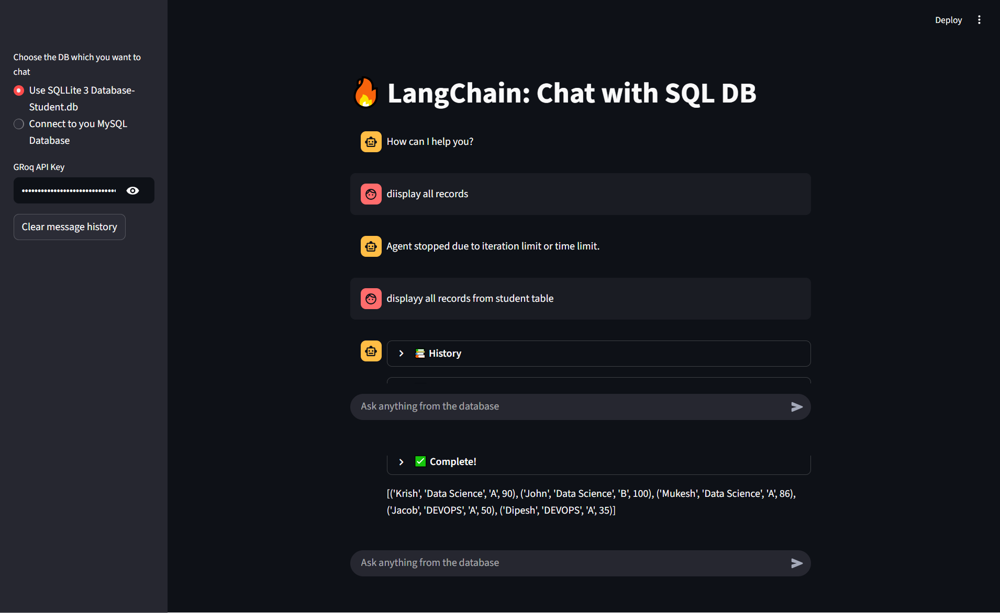
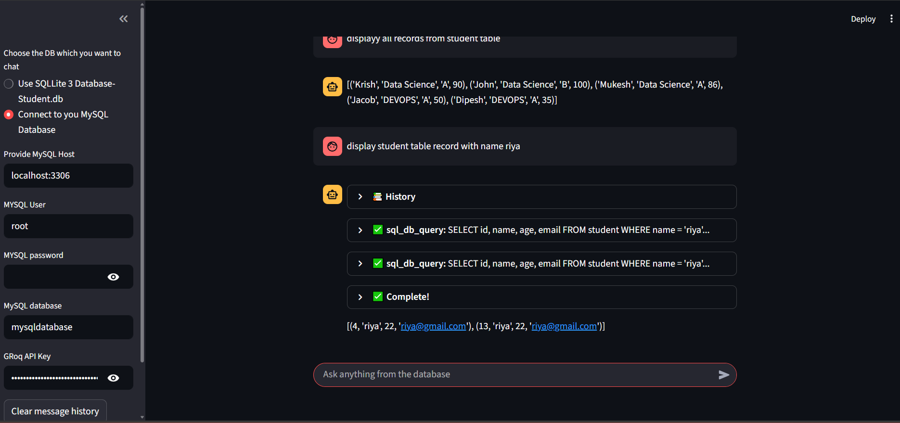

# LangChain SQL Database Chat Application

## Overview
The **LangChain SQL Database Chat Application** is an interactive AI-powered data querying tool built with **Streamlit** and **LangChain**. It enables users to query structured databases using **natural language** without writing SQL manually.

The application supports both **SQLite** and **MySQL** databases and uses a **Groq-hosted LLaMA 3.1 model** to convert user questions into SQL queries, execute them securely, and return human-readable answers in real time.

This project demonstrates practical implementation of **LLM-powered agents**, **SQL toolkits**, and **chat-based analytics**, making it highly suitable for backend, AI, and full-stack developer portfolios.

---

## Key Features
- Natural Language to SQL query conversion
- Chat-based interface with conversation memory
- Supports **SQLite3** (local database) and **MySQL**
- Real-time streaming responses using callbacks
- Secure database connection handling
- Modular LangChain agent architecture
- Optimized for scalable data analysis workflows

---

## Tech Stack
- **Python**
- **Streamlit** (UI and frontend)
- **LangChain**
- **LangChain Community Toolkits**
- **Groq LLM (LLaMA 3.1 – 8B Instant)**
- **SQLAlchemy**
- **SQLite3**
- **MySQL**
- **Agent-based AI Architecture**

---

## Architecture Overview
1. User enters a natural language query.
2. LangChain SQL Agent interprets the intent.
3. SQL query is generated using database schema context.
4. Query is executed on SQLite or MySQL.
5. Results are returned as conversational responses.
6. Streaming callbacks display intermediate reasoning.

---

## Supported Databases
### SQLite
- Uses a local `student.db` file
- Read-only mode for safety
- Ideal for demos and testing

### MySQL
- Connects using host, username, password, and database name
- Suitable for production-scale databases

---

## Tools and Components Used
- **ChatGroq**: LLM provider for fast inference
- **SQLDatabase**: Database abstraction layer
- **SQLDatabaseToolkit**: Provides SQL tools to the agent
- **create_sql_agent**: Zero-shot ReAct SQL agent
- **StreamlitCallbackHandler**: Live response streaming
- **AgentType.ZERO_SHOT_REACT_DESCRIPTION**

---

## 📸 Application Screenshots (Streamlit UI)

